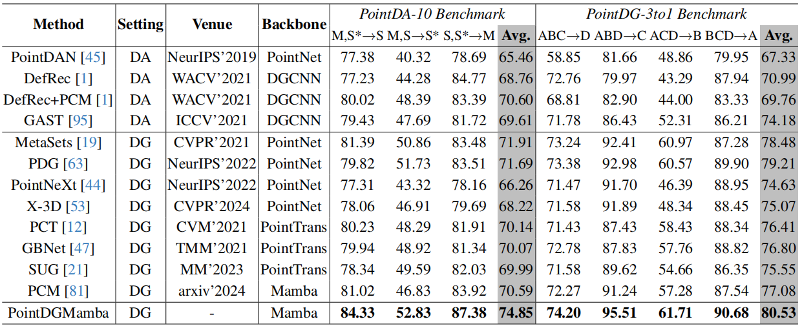
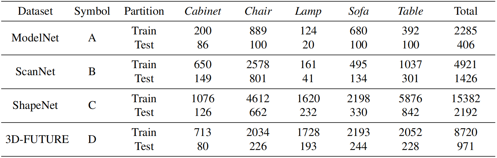
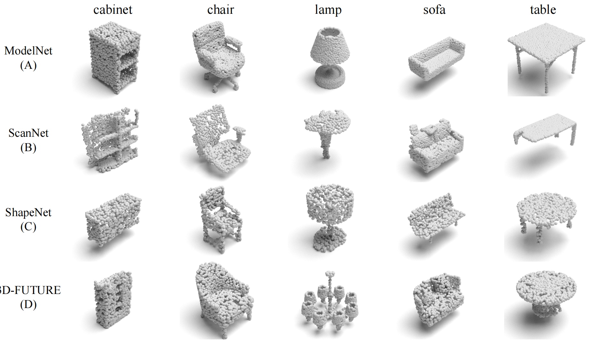

# PointDGMamba: Domain Generalization of Point Cloud Classification via Generalized State Space Model


The data is publicly available [here](https://pan.baidu.com/s/1nHDMYob9X87CMhR5cyVbTw?pwd=kj7d) with the extraction code **kj7d**.


## 1. Overview


## 2. Performance



## 3. PointDG-3to1 benchmark

We propose a multi-domain generalization benchmark named PointDG-3to1 consisting of four sub-datasets. 

### Number



### Visualization




# Getting Started with PointDGMamba

## A tested and feasible version

```
Python 3.10
cuda-11.8
gcc version 9.5.0 (Ubuntu 9.5.0-6ubuntu2) 
gcc version 9.5.0 (Ubuntu 9.5.0-6ubuntu2)
```


## Running

### PointDA-10 Benchmark

```
CUDA_VISIBLE_DEVICES=0 python examples/classification/main.py --cfg cfgs/ScanAndModel/PCM-Tiny.yaml
CUDA_VISIBLE_DEVICES=1 python examples/classification/main.py --cfg cfgs/ScanAndShape/PCM-Tiny.yaml
CUDA_VISIBLE_DEVICES=2 python examples/classification/main.py --cfg cfgs/ShapeAndModel/PCM-Tiny.yaml
```

### PointDG3to1 Benchmark

```
CUDA_VISIBLE_DEVICES=0 python examples/classification/main.py --cfg cfgs/ABC/PCM-Tiny.yaml
CUDA_VISIBLE_DEVICES=1 python examples/classification/main.py --cfg cfgs/ABD/PCM-Tiny.yaml
CUDA_VISIBLE_DEVICES=2 python examples/classification/main.py --cfg cfgs/ACD/PCM-Tiny.yaml
CUDA_VISIBLE_DEVICES=3 python examples/classification/main.py --cfg cfgs/BCD/PCM-Tiny.yaml
```

## Cite

If you use PointDGMamba in your research, please use the following BibTeX entry.

```
@article{yang2024pointdgmamba,
      title={PointDGMamba: Domain Generalization of Point Cloud Classification via Generalized State Space Model}, 
      author={Yang, Hao and Zhou, Qianyu and Sun, Haijia and Li, Xiangtai and Liu, Fengqi and Lu, Xuequan and Ma, Lizhuang and Yan, Shuicheng},
      journal={arXiv preprint arXiv:2408.13574},
      year={2024}
}
```


